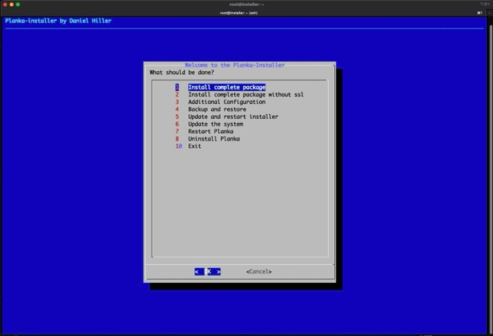

# Overview

## Demo

See the installer in action: https://www.youtube.com/watch?v=0Qya8iLDnq0



## Features

- Installs all required packages
- Installs PLANKA
- Configures Nginx reverse proxy
- Automates SSL certificates
- Automates backups
- Automates updates
- Configures Fail2Ban and Firewall
- Creates the first admin user

## Roadmap

- Clean up the code
- Consider additional features

## Backups

Backups will be stored here:

```bash
/opt/planka/backup
```

You can create and restore backups from the "Backup and restore" menu of the installer.

## Logs

Logs can be found here:

```bash
/opt/planka/logs
```

## Uninstalling / Reinstalling

You can reinstall PLANKA using the "Uninstall PLANKA" option in the installer.

This does the following:

- Delete PLANKA containers
- Delete all Docker volumes
- Delete the Nginx configuration

Backups are never deleted.

## Some Notes

- No, I will not support your favorite Linux distribution.
- No, I will not support Windows.
- No pull requests for typo fixes.

## License

[AGPL-3.0 License](https://github.com/plankanban/planka-installer/blob/main/LICENSE)
